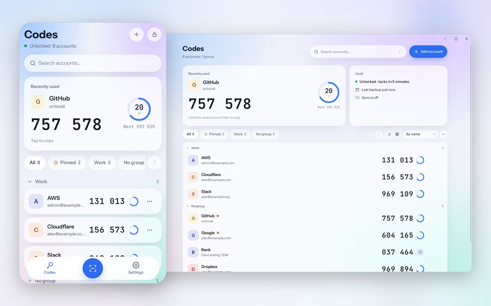
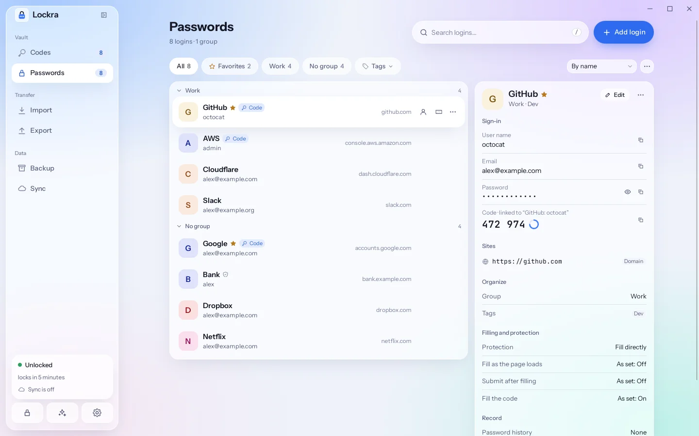
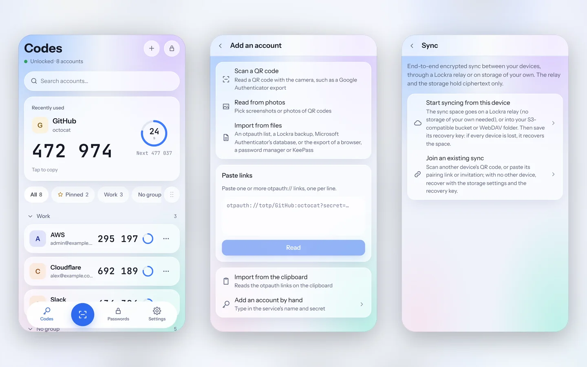
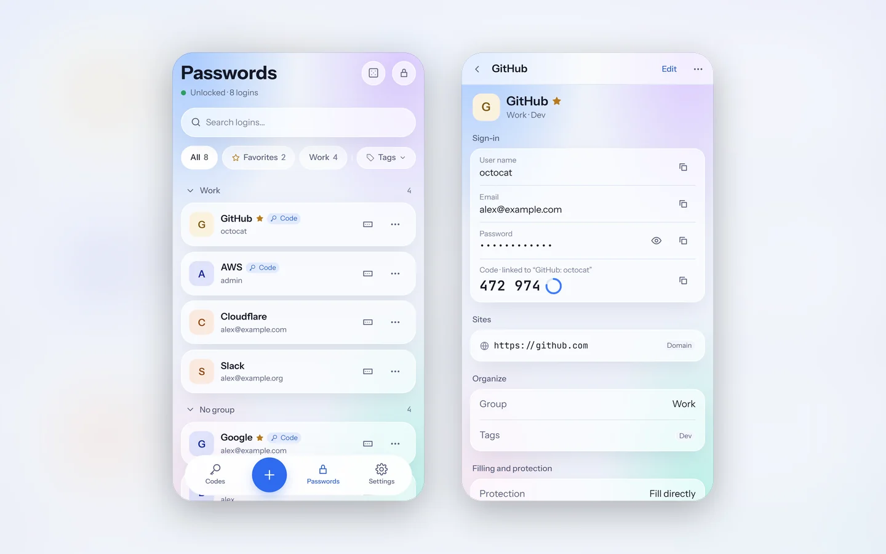

<div align="center">


# Lockra

### Two-factor codes and passwords on your computers and your phone, encrypted and in sync.

[](https://github.com/sunerpy/lockra/actions/workflows/ci.yml)
[](https://github.com/sunerpy/lockra/releases)
[](./LICENSE)

[Highlights](#highlights) · [Demo](#demo) · [Features](#features) · [Screenshots](#screenshots) · [Install](#install) · [Quick start](#quick-start) · [Documentation](https://firlab.app/lockra/) · [Development](#development)

[**English**](./README.md) · [简体中文](./docs/readme/README.zh-CN.md)

</div>

---

Lockra is a two-factor authenticator and password manager for Windows, macOS, Linux and Android.
Your codes and passwords live in an encrypted file on each of your devices, and Lockra goes online
only for its updates and, once you turn it on, for end-to-end encrypted sync between them. Its
browser extension for Chrome, Edge and Firefox fills your logins and their codes. Lockra moves your
accounts in from Google Authenticator and Microsoft Authenticator and back out, imports passwords
from browsers and password managers, and keeps encrypted backups in a folder you choose. The
passwords and the extension are new in 0.10.0.



## Highlights

- **Passwords, new in 0.10.0**: logins beside the codes in the same vault, under one master
  password and in one backup, on the computer and on the phone. A generator makes passwords to
  sites' own rules, and logins come in from Chrome, Edge, Firefox, Safari, Bitwarden, 1Password,
  LastPass and KeePass.
- **A browser extension that fills for you**: in Chrome, Edge and Firefox it fills a login and then
  its code, page by page when a sign-in asks for them one at a time, and, if you let it, submits the
  form once the password or the linked code is in. It offers to save and update passwords, makes one
  on a sign-up form, can take the browser's own password prompts over, and opens its menu clear of
  the browser's list. It keeps no passwords: it asks Lockra on the same computer, which decides
  every fill.
- **Every device**: one app for Windows, macOS and Linux (x64 and ARM64) and Android 8 or later,
  with the same design, eight themes, and Chinese and English. An iPhone and iPad app is planned.
- **The same accounts everywhere**: end-to-end encrypted sync through the built-in Lockra relay
  (nothing to set up), a relay you run, an S3-compatible bucket, a WebDAV folder or, between
  computers, a cloud drive folder. Each device encrypts before anything leaves it, so the relay or
  storage holds ciphertext only.
- **Pairing by QR code**: a phone joins by scanning the computer's QR code, or by pasting its
  pairing link or invitation; a recovery key brings the space back if every device is lost.
- **No account**: no sign-up, no telemetry and no server that can read your codes or passwords.
  Move your accounts in from Google Authenticator or Microsoft Authenticator, and back out again.

## Demo

Signing up on a site with a password Lockra makes to its rules, turning on its two-step
verification, and signing in page by page with the login and the code filled in; then the command
palette, the generator and the themes. Recorded with the real app and its browser extension, on a
made-up site; a sharper version plays on the [website](https://firlab.app/lockra/).


## Features

- **Codes**: TOTP (SHA1, SHA256, SHA512, 6–8 digits, any period) and HOTP. Click a row to copy;
  the clipboard is cleared after 30 seconds if it still holds the code, and the next code shows in
  a code's last five seconds. Search, groups, pinned accounts and hidden codes.
- **Import**: Google Authenticator's _Transfer accounts_ QR codes (photos or screenshots, several
  at once), Microsoft Authenticator's database from a rooted Android phone, `otpauth://` links and
  lists, and Lockra backups. A preview marks every account as new, existing, conflicting or
  unsupported, with the reason, before anything is saved.
- **Export**: migration QR codes for Google Authenticator, one standard code per account for
  Microsoft Authenticator, or a plain list. Each asks for the master password again and shows the
  current codes beside the QR code so you can check the phone.
- **Passwords** (from 0.10.0): logins with a user name and an email address, a password, sites
  matched by domain, host or a pattern, notes, custom fields, tags, groups and a linked code; a
  protection level per login (fill directly, verify first, or not for the extension) and a
  password history. A generator makes random passwords and passphrases to sites' password rules.
  Logins import from Chrome, Edge, Firefox, Safari, Bitwarden, 1Password, LastPass and KeePass
  (KDBX 4), and export to KeePass or a plain CSV file. The phone shows, copies and edits them
  ([passwords guide](https://firlab.app/lockra/passwords/)).
- **Browser extension** (Chrome, Edge and Firefox, on Windows, macOS and Linux): it keeps no
  passwords and asks the running Lockra over an end-to-end encrypted local channel, paired once by
  comparing a six-digit code. It fills from its popup, with `Ctrl Shift L` or from a menu by the
  field. One fill carries a sign-in over several pages: the user name, then the password on the
  next page, then the linked code. With _Submit after filling_ on, a form is sent only once its
  password is in, or the code for a login with a linked one. It offers to save and update
  passwords, and can turn off the browser's own offer to save them, so that only Lockra asks.
  Lockra decides every fill, and can keep running in the tray for it. Chrome, Edge and Brave load
  it unpacked from the release; the Edge Add-ons and Firefox Add-ons listings, which Firefox needs,
  are not live yet ([extension guide](https://firlab.app/lockra/passwords/browser)).
- **Quick search** (from 0.10.0, on Windows, macOS and Linux): a key combination of your own
  brings up the command palette over any app, to copy a user name, a password or a code; on
  Wayland, bind `lockra-desktop --palette` in the desktop's settings instead
  ([quick search](https://firlab.app/lockra/passwords/#quick-search-from-anywhere)).
- **Backups**: encrypted `.lockrabackup` files on demand, and automatic ones into a folder (a
  OneDrive, Google Drive or iCloud folder works) a few seconds after each change, keeping the
  newest few. Restore by merging or by replacing.
- **Phone**: the Android app (Android 8 or later, ARM64) keeps the same vault as the computer. It
  scans QR codes with the camera or reads them from screenshots, unlocks with a fingerprint whose
  key stays in the phone's secure hardware, locks as soon as you leave it, never allows
  screenshots, and joins your computers' sync by scanning a QR code. An iPhone and iPad app is
  planned ([platform notes](https://firlab.app/lockra/reference/platforms#android)).
- **Sync**: end-to-end encrypted, between your computers and the Android app, through an
  S3-compatible bucket, a WebDAV folder, a folder your cloud drive keeps in sync or, from 0.8.1, a
  Lockra relay ([below](#sync-relay)). A phone joins by scanning the computer's QR code. Whatever
  keeps the space sees encrypted files only
  ([sync guide](https://firlab.app/lockra/backup/sync)).
- **Security**: Argon2id and XChaCha20-Poly1305, optional unlock with the system keychain,
  auto-lock, and screen-capture protection while a secret is shown (Windows and macOS).
- **Updates**: the title bar tells you when a new version is out and opens the update dialog
  (its notes, the download with its speed, the restart); with automatic updates on, Lockra
  downloads it at start and installs it when you restart. A package is installed only when it
  carries Lockra's signature, through the package Lockra was installed from (deb, rpm, AppImage,
  the Windows installer or the macOS app).
- **Interface**: eight themes (Clear sky by default, which follows the system's light or dark
  mode), eight accents, a list or cards, Chinese and English, a command palette (`Ctrl K`) and
  keyboard shortcuts throughout. On a computer, a tray icon (from 0.10.0) opens the window, the
  quick search, the settings and the update check, and locks the vault.

## Screenshots

The passwords page on a computer: the logins in their groups, and the one chosen with its linked
code.



The Android app: the codes page, adding an account, and sync; and the logins on the phone.





More pages, on a computer and on the phone, are in the [documentation](https://firlab.app/lockra/).

## Install

1. **One command**: the script picks the package for your computer, checks it against the
   release's `SHA256SUMS` and installs it
   ([install guide](https://firlab.app/lockra/guide/install#install-with-one-command)).

   ```bash
   # Linux and macOS
   curl -fsSL https://raw.githubusercontent.com/sunerpy/lockra/main/scripts/install.sh | sh
   ```

   ```powershell
   # Windows (PowerShell)
   irm https://raw.githubusercontent.com/sunerpy/lockra/main/scripts/install.ps1 | iex
   ```

2. **Download a package** from the [releases page](https://github.com/sunerpy/lockra/releases):
   the Windows installer (x64 and ARM64), a dmg for Apple silicon or Intel Macs, a deb, rpm or
   AppImage for Linux (x64 and ARM64), or the APK for Android phones (ARM64, Android 8 or later;
   [Android](https://firlab.app/lockra/guide/install#android)). Every release carries `SHA256SUMS`
   and build attestations:

   ```bash
   sha256sum -c SHA256SUMS --ignore-missing
   gh attestation verify Lockra_*_amd64.deb --repo sunerpy/lockra
   ```

   The packages are not code-signed yet: Windows SmartScreen and macOS Gatekeeper ask before the
   first start ([platform notes](https://firlab.app/lockra/reference/platforms)).

3. **Build from source** ([Development](#development)).

From 0.2.0, Lockra updates itself: **Settings › General › Check for updates**, or the note in the
title bar ([updates](https://firlab.app/lockra/guide/updates)).

## Sync relay

From 0.8.1, devices without storage of their own sync through a Lockra relay. The built-in relay
needs nothing set up. To run your own, every release carries `lockra-relay` for Linux (x64 and
ARM64) with a systemd unit, and `deploy/relay/` also has a Docker Compose file that puts Caddy and
its automatic HTTPS in front of it:

```bash
RELAY_HOST=relay.example.com docker compose -f deploy/relay/compose.yaml up -d
```

A relay keeps the devices' encrypted snapshots and nothing else: the key that seals them and the
sync key never reach it, and the devices show it an access token derived from the sync key, of
which it keeps only a hash. It sees when devices sync and from which addresses
([self-hosting guide](https://firlab.app/lockra/backup/relay), [docs/relay.md](docs/relay.md),
[security model](docs/security.md#the-relay)).

## Quick start

1. Start Lockra and choose a master password. It cannot be recovered, so keep it somewhere safe.
2. Bring your accounts in on the Import page: photos of Google Authenticator's export codes, links
   pasted or read from the clipboard, or a backup. Passwords come from a browser's or a password
   manager's export the same way.
3. Click an account to copy its code. Turn on automatic backups on the Backup page.

The [documentation](https://firlab.app/lockra/) covers each step, moving accounts from and to
phones, backups, security and questions.

## Development

Rust 1.98 (`rust-toolchain.toml`), Node ≥ 20.19 with pnpm 9, and on Linux webkit2gtk 4.1.
`make check` also needs Python ≥ 3.9, cargo-llvm-cov, cargo-deny, actionlint and shellcheck, and
names any that is missing before it starts.

```bash
pnpm install --frozen-lockfile
pnpm --filter @lockra/desktop tauri dev   # the app with hot reload
pnpm dev                                  # the interface alone, on an in-memory core
make check                                # every gate
make help                                 # everything else
```

[CONTRIBUTING.md](CONTRIBUTING.md) is the workflow, [AGENTS.md](AGENTS.md) the rules,
[docs/architecture.md](docs/architecture.md) the code, [docs/formats.md](docs/formats.md) the file
formats, [docs/security.md](docs/security.md) the security model and
[docs/release.md](docs/release.md) the release process.

## License

[Apache-2.0](./LICENSE). The interface design is derived from
[Voltip](https://github.com/sunerpy/voltip); the bundled fonts are under the SIL Open Font License
1.1 ([NOTICE](./NOTICE)).
