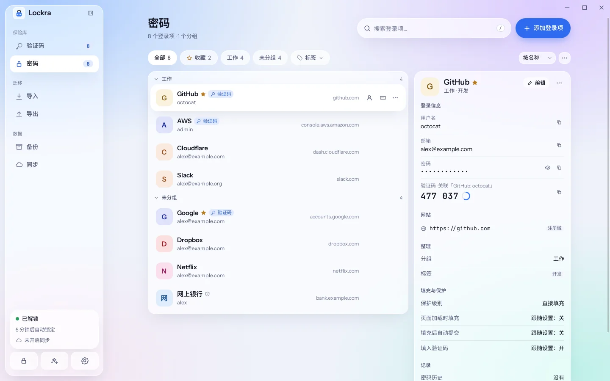
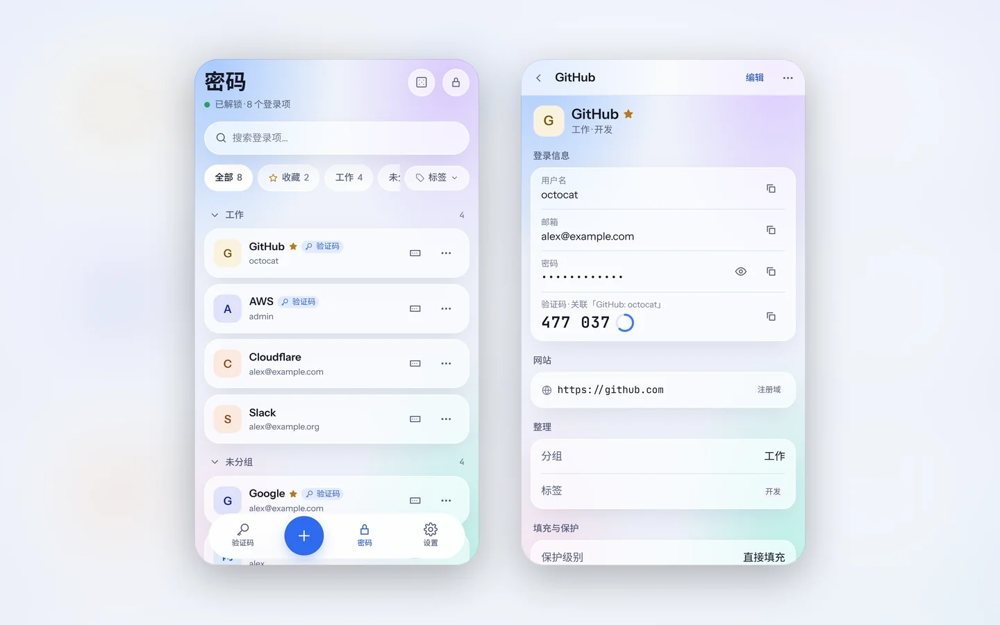

<div align="center">


# Lockra

### 两步验证码和密码保存在你的电脑和手机上，加密，多端同步。

[](https://github.com/sunerpy/lockra/actions/workflows/ci.yml)
[](https://github.com/sunerpy/lockra/releases)
[](../../LICENSE)

[亮点](#亮点) · [演示](#演示) · [特性](#特性) · [截图](#截图) · [安装](#安装) · [快速开始](#快速开始) · [文档](https://firlab.app/lockra/zh/) · [开发](#开发)

[English](../../README.md) · [**简体中文**](./README.zh-CN.md)

</div>

---

Lockra 是一个两步验证器，也是密码管理器，支持 Windows、macOS、Linux 和 Android。验证码和密码保存在每台设备的
加密文件中，Lockra 只为自身的更新以及你开启的设备间端到端加密同步联网。适用于 Chrome、Edge 和 Firefox 的浏览器
扩展会把登录项及其验证码填入网页。Lockra 可以从 Google 身份验证器和 Microsoft Authenticator 迁入账号，也可以
迁回去；可以从浏览器和密码管理器导入密码，并把加密备份写入你选择的文件夹。密码和浏览器扩展是 0.10.0 的新功能。


## 亮点

- **密码管理（0.10.0 新增）**：登录项与验证码保存在同一个保险库中，一个主密码、一份备份，电脑和手机上都可以
  使用。密码生成器按网站自己的规则生成密码；登录项可以从 Chrome、Edge、Firefox、Safari、Bitwarden、1Password、
  LastPass 和 KeePass 导入。
- **替你填写的浏览器扩展**：在 Chrome、Edge 和 Firefox 中先填入登录项，再填入它的验证码；分几页的登录会逐页接着
  填，开启自动提交后，填入密码或关联的验证码才提交表单。扩展会提示保存和更新密码，在注册表单中生成密码，可以
  接管浏览器自带的保存密码提示，菜单也避开浏览器自己的密码列表。扩展本身不保存密码，而是向同一台电脑上的
  Lockra 请求，每一次填充都由 Lockra 决定。
- **多端支持**：同一个应用覆盖 Windows、macOS、Linux（x64 与 ARM64）和 Android 8 及以上，界面设计一致，
  提供八套主题和中英文界面。iPhone 与 iPad 版在计划中。
- **多端同步**：在你自己的存储上（S3 兼容存储桶、WebDAV 文件夹，或在电脑之间经网盘同步文件夹），或经 Lockra
  中继（自建中继，或用内置中继试用），端到端加密地同步，每台设备上的账号保持一致。内容在离开设备之前就已加密，
  存储或中继里只有密文。
- **扫码配对**：手机扫描电脑上的二维码即可加入，也可以粘贴配对链接或邀请码；所有设备都丢失时，可以用恢复密钥
  找回同步空间。
- **无需账号**：无需注册，没有遥测，也没有能读取验证码或密码的服务器。账号可以从 Google 身份验证器或 Microsoft
  Authenticator 迁入，也可以迁回去。

## 演示

在网站上用 Lockra 按规则生成的密码注册，开启这个网站的两步验证，再分几页登录，登录项和验证码自动填入；然后是
命令面板、密码生成器和主题。录制时使用的是真实的应用和浏览器扩展，网站是虚构的演示站点；更清晰的版本在
[网站](https://firlab.app/lockra/zh/)上播放。


## 特性

- **验证码**：TOTP（SHA1、SHA256、SHA512，6–8 位，任意周期）和 HOTP。点击一行即复制；30 秒后，如果剪贴板中
  仍是这个验证码就会清空；验证码在最后 5 秒同时显示下一个。支持搜索、分组、收藏和隐藏验证码。
- **导入**：Google 身份验证器「转移账号」生成的二维码（照片或截图，可一次选多张）、已 root 的 Android 手机上
  Microsoft Authenticator 的数据库、`otpauth://` 链接与列表，以及 Lockra 备份。保存之前先给出预览，逐条标明
  新增、已存在、同名不同密钥或不支持，并说明原因。
- **导出**：给 Google 身份验证器的迁移二维码、给 Microsoft Authenticator 的每个账号一张标准二维码，或者明文列表。
  每种方式都要再次输入主密码，二维码旁边显示当前验证码，方便与手机核对。
- **密码**（0.10.0 起）：登录项包含用户名和邮箱、密码、按注册域、主机或模式匹配的网址、备注、自定义字段、
  标签、分组和关联的验证码；每个登录项有自己的保护级别（直接填充、填充前验证，或不交给扩展）和密码历史。
  密码生成器可以按网站的密码规则生成随机密码和口令。登录项可以从 Chrome、Edge、Firefox、Safari、Bitwarden、
  1Password、LastPass 和 KeePass（KDBX 4）导入，并导出为 KeePass 数据库或明文 CSV 文件。手机上可以查看、复制和
  编辑登录项（[密码指南](https://firlab.app/lockra/zh/passwords/)）。
- **浏览器扩展**（Windows、macOS 和 Linux 上的 Chrome、Edge 和 Firefox）：扩展本身不保存密码，而是经端到端
  加密的本机通道向正在运行的 Lockra 请求，只需核对一次 6 位代码完成配对。可以从弹窗、用 `Ctrl Shift L` 或从
  输入框旁的菜单填充。分几页的登录只需填一次：先填用户名，下一页自动填入密码，再填入关联的验证码。
  开启「填充后自动提交」时，填入密码后才提交，关联了验证码的登录项则在填入验证码后才提交。扩展会提示保存和
  更新密码，也可以关闭浏览器自带的保存密码提示，只由 Lockra 提示。每一次填充都由 Lockra 决定，Lockra 可以为此
  留在托盘中运行。Chrome、Edge 和 Brave 以解压方式加载 Lockra 保存扩展的文件夹，Lockra 更新时会一并更新它（自 0.11.1 起）；Edge 加载项和 Firefox 附加组件的页面
  尚未上线，Firefox 只能从后者安装（[扩展指南](https://firlab.app/lockra/zh/passwords/browser)）。
- **全局快捷搜索**（0.10.0 起，Windows、macOS 和 Linux）：在任何应用里按下自己设定的组合键唤出命令面板，复制
  用户名、密码或验证码；在 Wayland 上改为在桌面环境的设置里绑定 `lockra-desktop --palette`
  （[全局快捷搜索](https://firlab.app/lockra/zh/passwords/#全局快捷搜索)）。
- **备份**：随时手动备份为加密的 `.lockrabackup` 文件；也可以在每次修改几秒后自动备份到指定文件夹（OneDrive、
  Google Drive 或 iCloud 的同步文件夹均可），只保留最近几份。恢复时可以合并，也可以整体替换。
- **手机端**：Android 应用（Android 8 及以上，ARM64）与电脑使用同样的保险库：可以用相机扫描二维码，也可以
  读取截图中的二维码；用指纹解锁，密钥保存在手机的安全硬件中；离开应用即锁定，界面始终禁止截屏；扫描电脑上的
  二维码即可加入同步。iPhone 与 iPad 版在计划中（[平台说明](https://firlab.app/lockra/zh/reference/platforms#android)）。
- **同步**：在电脑和 Android 应用之间端到端加密同步，可以通过 S3 兼容存储桶、WebDAV 文件夹、网盘客户端同步的
  文件夹，或从 0.8.1 起通过 Lockra 中继（[见下文](#同步中继)）。手机扫描电脑上的二维码即可加入。保存同步空间
  的一方只能看到加密的文件（[同步指南](https://firlab.app/lockra/zh/backup/sync)）。
- **安全**：Argon2id 与 XChaCha20-Poly1305，可选用系统钥匙串解锁，自动锁定，显示密钥时阻止截屏（Windows 和
  macOS）。
- **更新**：有新版本时，标题栏会提示，并可打开更新对话框（更新内容、带速度的下载进度、重启）；开启自动更新后，
  Lockra 在启动时下载新版本，重启时完成安装。只安装带有 Lockra 签名的安装包，并通过 Lockra 原来的安装方式
  （deb、rpm、AppImage、Windows 安装程序或 macOS 应用）完成安装。
- **界面**：八套主题（默认「澄空」，跟随系统的浅色与深色）、八种强调色，列表或卡片视图，中英文界面，
  命令面板（`Ctrl K`），全程可用键盘操作。在电脑上，托盘图标（0.10.0 起）可以打开窗口、全局快捷搜索、设置和
  检查更新，也可以锁定保险库。

## 截图

电脑上的密码页：按分组排列的登录项，以及选中的登录项和它关联的验证码。



Android 应用：验证码页、添加账号和同步，以及手机上的登录项。




电脑和手机上的更多页面，见[文档](https://firlab.app/lockra/zh/)。

## 安装

1. **一键安装**：脚本会为当前电脑选择对应的安装包，用该版本的 `SHA256SUMS` 校验后安装
   （[安装指南](https://firlab.app/lockra/zh/guide/install#一键安装)）。

   ```bash
   # Linux 和 macOS
   curl -fsSL https://raw.githubusercontent.com/sunerpy/lockra/main/scripts/install.sh | sh
   ```

   ```powershell
   # Windows（PowerShell）
   irm https://raw.githubusercontent.com/sunerpy/lockra/main/scripts/install.ps1 | iex
   ```

2. **下载安装包**：在[发布页](https://github.com/sunerpy/lockra/releases)选择 Windows 安装程序（x64 与 ARM64）、
   适用于 Apple 芯片或 Intel Mac 的 dmg、适用于 Linux（x64 与 ARM64）的 deb、rpm、AppImage，或适用于 Android
   手机的 APK（ARM64，Android 8 及以上；[Android](https://firlab.app/lockra/zh/guide/install#android)）。每个版本都附带
   `SHA256SUMS` 和构建证明：

   ```bash
   sha256sum -c SHA256SUMS --ignore-missing
   gh attestation verify Lockra_*_amd64.deb --repo sunerpy/lockra
   ```

   安装包目前尚未签名，首次启动时 Windows SmartScreen 和 macOS Gatekeeper 会提示确认
   （[平台说明](https://firlab.app/lockra/zh/reference/platforms)）。

3. **从源码构建**（见[开发](#开发)）。

从 0.2.0 起，Lockra 可以自行更新：「设置 › 通用 › 检查更新」，或标题栏中的提示（[更新说明](https://firlab.app/lockra/zh/guide/updates)）。

## 同步中继

从 0.8.1 起，没有自己存储的设备可以通过 Lockra 中继同步。内置中继无需任何设置，适合试用同步：它是免费运行的
一台服务器，不作服务保证，长期依赖的同步空间请自建中继或使用你自己的存储。自建中继时，每个版本都提供
Linux 版 `lockra-relay`（x64 与 ARM64）及其 systemd 服务；`deploy/relay/` 中还有一个 Docker Compose 文件，
在中继前面运行 Caddy 并自动配置 HTTPS：

```bash
RELAY_HOST=relay.example.com docker compose -f deploy/relay/compose.yaml up -d
```

中继只保存设备加密后的快照：加密快照的密钥和同步密钥都不会到达中继；设备向中继出示由同步密钥派生的访问令牌，
中继只保存它的哈希。中继能看到设备何时、从哪些地址同步（[自建指南](https://firlab.app/lockra/zh/backup/relay)、
[docs/relay.md](../relay.md)（英文）、[安全模型](../security.md#the-relay)（英文））。

## 快速开始

1. 启动 Lockra，设置主密码。主密码无法找回，请妥善保管。
2. 在「导入」页导入账号：Google 身份验证器导出二维码的照片、粘贴或从剪贴板读取的链接，或者一个备份。浏览器或
   密码管理器导出的密码也以同样的方式导入。
3. 点击账号即可复制验证码。在「备份」页开启自动备份。

[文档](https://firlab.app/lockra/zh/)详细介绍了每一步、在手机与电脑之间迁移账号、备份、安全和常见问题。

## 开发

需要 Rust 1.98（见 `rust-toolchain.toml`）、Node ≥ 20.19 和 pnpm 9；Linux 上还需要 webkit2gtk 4.1。
`make check` 另外需要 Python ≥ 3.9、cargo-llvm-cov、cargo-deny、actionlint 和 shellcheck，缺少其中
任何一个时，会在开始检查前列出。

```bash
pnpm install --frozen-lockfile
pnpm --filter @lockra/desktop tauri dev   # 带热重载的桌面应用
pnpm dev                                  # 只运行界面，后端是内存中的模拟核心
make check                                # 全部检查
make help                                 # 其余命令
```

开发流程见 [CONTRIBUTING.md](../../CONTRIBUTING.md)，代码约定见 [AGENTS.md](../../AGENTS.md)，代码结构见
[docs/architecture.md](../architecture.md)，文件格式见 [docs/formats.md](../formats.md)，安全模型见
[docs/security.md](../security.md)，发布流程见 [docs/release.md](../release.md)。

## 许可证

[Apache-2.0](../../LICENSE)。界面设计源自 [Voltip](https://github.com/sunerpy/voltip)；随附字体采用 SIL Open Font
License 1.1（[NOTICE](../../NOTICE)）。
